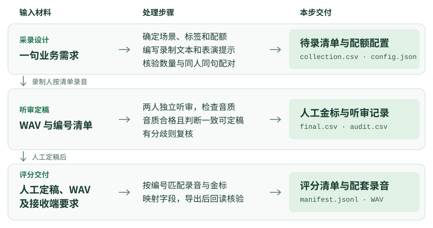

# 语音情绪评测集构建与听审

把想检验的问题告诉 `speech-emotion-eval`，即可生成逐条可录的清单。已有录音或人工定稿时，也可以从相应阶段开始。

[首次安装](#首次安装与使用) · [试用听审网页](review/README.md) · [导出评分清单](#使用自己的录音和定稿)

## 工作流程

按手头的材料选择起点。只需要采录清单时，完成「采录设计」即可开始录音。

<picture>
  <source media="(max-width: 650px)" srcset="./docs/workflow-mobile.svg">
  
</picture>

[查看大图](docs/workflow.svg) · [查看 Mermaid 源图](docs/workflow.mmd)

## 生成结果示例

**输入一句需求**

> 想测家庭语音助手能否区分平静表达和带情绪的表达。灯光状态和物品位置各做一条中性，再各做一组同人同句的开心、惊讶对照。

**生成的采录清单**共 6 条。每个场景先列一条中性表达，接着列出 A、B 两种读法，便于对照同一句话怎样读出不同的情绪。

### 场景一 · 灯光状态

| 样本编号 | 配对编号 | 语气要求 | 录制文本 | 表演提示 |
|---|---|---|---|---|
| L01 | — | 中性 | 玄关的灯开着，走廊的灯关着。 | 像在回答家里哪些灯还开着。两处地点之间自然停一下，照常说完。 |
| L02A | P01 | 开心 | 你看，门口那盏灯又亮了。 | 刚修好的灯终于能用了，招呼家人来看。“又亮了”带一点笑意，句尾放松。 |
| L02B | P01 | 惊讶 | 你看，门口那盏灯又亮了。 | 明明记得刚关过灯。说到“又”时音调稍抬，像刚发现灯亮着。 |

### 场景二 · 物品位置

| 样本编号 | 配对编号 | 语气要求 | 录制文本 | 表演提示 |
|---|---|---|---|---|
| K01 | — | 中性 | 遥控器在茶几下面那层，靠沙发这边。 | 家里人问遥控器放在哪儿。平常音量回答，最后几个字自然带过。 |
| K02A | P02 | 开心 | 那张照片还夹在这本书里。 | 想找这张老照片给家人看，翻书时找着了。把“还夹在”说得轻快些。 |
| K02B | P02 | 惊讶 | 那张照片还夹在这本书里。 | 原以为照片早就收进相册了。把“这本书里”稍稍读重，像在确认眼前所见。 |

录制人只读“录制文本”列。每个配对编号对应两条录音，由同一人逐字读同一句话。例如，P01 的两条分别保存为 `L02A.wav` 和 `L02B.wav`。两条中性样本各用独立原文，因此这批共有 **4 段原文、2 组对照**。表中的情绪是朗读预设，人工金标在听审后确定。

[下载这 6 条的 Excel 清单](examples/home-recording-list/家庭语音助手采录清单.xlsx?raw=true) · [原始 CSV](examples/home-recording-list/collection.csv) · [配额配置](examples/home-recording-list/config.json) · [录制说明](examples/home-recording-list/README.md)

## 首次安装与使用

下面以本机 Codex 为例。在项目中安装一次，以后只需在同一项目的对话框里描述需求。编写采录清单时无需预先准备音频。

### 1. 打开工作目录

首次使用 Codex，请先安装并登录，在电脑上新建一个文件夹，例如 `voice-eval-work`，然后在 Codex 中将它作为项目打开。[Codex 官方快速入门](https://developers.openai.com/codex/quickstart/)

清单核验脚本使用 Python 3.10 或更高版本，只依赖标准库。Windows 可在终端用 `py -3 --version` 查看版本，macOS 或 Linux 可用 `python3 --version`。如果电脑还没有可用的 Python，可从官网下载。[Python 下载页](https://www.python.org/downloads/)

### 2. 在 Codex 对话中安装

把下面这行复制到刚打开的**项目对话框**并发送。

```text
$skill-installer 请从 https://github.com/Xiang-mira/speech-emotion-eval-skill/tree/main/skills/speech-emotion-eval 安装到当前项目。使用安装器的 --dest .agents/skills 参数，安装后读取 .agents/skills/speech-emotion-eval/SKILL.md，确认名称是 speech-emotion-eval。
```

安装成功的标志是**自己的项目文件夹**中出现 `.agents/skills/speech-emotion-eval/SKILL.md`。在同一项目开一个新对话，发送下一步的需求即可。

**手动安装。** 如果对话内安装失败，或项目里找不到上述文件，可以在本仓库首页选择 **Code → Download ZIP** 并解压。在自己的项目文件夹中新建 `.agents` 文件夹，再在里面新建 `skills` 文件夹。把解压目录中的 `skills/speech-emotion-eval` 整个复制进去，确认入口路径与上面一致。若新对话仍找不到技能，重启 Codex 后重新打开这个项目。[Codex 技能使用说明](https://developers.openai.com/codex/skills/)

### 3. 一句话生成第一份清单

将下面整行复制到新对话。开头的 `$speech-emotion-eval` 指定已安装的技能，后半句写自己的场景、情绪与数量。

> $speech-emotion-eval 请在本项目的 my-first-eval 目录生成家庭语音助手采录清单，灯光状态和物品位置各一条中性，再各做一组同人同句的开心、惊讶对照，写好录制文本和表演提示，并核验配额与配对。

完成后，在项目中打开 `my-first-eval/collection.csv`，每行就是一条录制任务。录制人只读 `text`，按 `intended_label` 的语气和 `cue` 的提示表演，再按 `audio` 给出的路径保存 WAV。相同 `pair_id` 的两行由同一人录制。Excel 中若出现中文乱码，可用「数据 → 自文本/CSV」按 UTF-8 导入。同目录的 `config.json` 记录这次需求的标签与配额。

需要自行复验时，在 `voice-eval-work` 项目根目录运行下面的命令。macOS 或 Linux 将开头的 `py -3` 换为 `python3`。

```sh
py -3 .agents/skills/speech-emotion-eval/scripts/pipeline.py check --project my-first-eval
```

对上面的示例，核验应返回 `ok: true`、`records: 6`、`unique_texts: 4`、`pairs: 2`。换需求后，分别对照新配额检查任务数、不同文本数和配对组数。例如每个场景再加一条独立的中性表达，三项就变成 8、6、2。录制前即可完成这一步。拿到 WAV 后，如需组织双人听审，再按下一节启动网页。

## 试用听审网页

下载并解压完整仓库，在根目录运行以下命令。需要 Python 3.10 或更高版本。Windows 也可双击 `Start-Demo.cmd`，或将命令中的 `python` 换成 `py -3`。

```sh
python run.py demo
```

首次运行会创建 `work/demo/` 及其清单、配置，再使用[听审演示文本](examples/demo/collection.csv)在本机准备六段 WAV。Windows 优先使用 PowerShell 和 System.Speech 可访问的中文语音。也可使用带普通话语音的 eSpeak NG，Linux 和 macOS 采用这一路径。若首次启动提示缺少合成引擎，在已创建的工作目录中按清单的文件名将六段自备 WAV 放入 `work/demo/audio/`，再运行同一命令。首页的待录清单与听审演示使用不同文本，各自配套使用。

1. 终端会显示两个听审人专属链接。分别用两个独立浏览器会话打开，逐段在页面中播放、判断、提交。听审进度保存在 `work/demo/`。
2. 两人均提交整轮后，一致且音质合格的样本得到人工金标。有分歧时，一方复听后提出带理由的结论，另一方确认同一版本。第三人裁定演示使用 `python run.py demo --mode third --port 8766`，数据写入 `work/demo-third/`。
3. 从网页下载定稿清单和审计记录。终端按 Ctrl+C 结束服务，再次启动同一模式即可继续。

## 使用自己的录音和定稿

| 现有材料 | 操作 | 交付结果 |
|---|---|---|
| 业务需求、候选句或旧表 | 用技能生成场景、录制文本及配额，逐组核验 | 覆盖设计、采录清单、配置和核验结果 |
| 录音和编号清单 | 准备 `collection.csv`、`config.json` 和相对路径对应的 WAV，运行 `python run.py review --project 项目目录` | 初审原判、分歧、复核结论及审计记录 |
| 人工定稿和对应录音 | 确认版本与质量依据，配置字段和标签映射，导出 JSONL | 评分清单、配套 WAV 和回读核验结果 |

以下命令以双人演示为例。将网页下载的定稿清单保存为 `work/demo/final.csv` 后运行：

```sh
python skills/speech-emotion-eval/scripts/pipeline.py check --project work/demo
python skills/speech-emotion-eval/scripts/pipeline.py audio --project work/demo
python skills/speech-emotion-eval/scripts/pipeline.py export --project work/demo --final work/demo/final.csv --profile examples/demo/profile.json --out work/demo/manifest.jsonl
```

接收端字段、标签和音频要求可按实际协议设置。[七类 WAV 映射示例](examples/profiles/seven-label-wav.json)要求单条不超过 30 秒，并对多声道文件指定语音通道。通用采录阶段的时长以本轮需求为准。

## 方法与验证

技能入口遵循 Agent Skills 规范。`SKILL.md` 中的 `name` 与技能目录同名，`description` 说明适用任务。场景设计、听审与交付的详细规则分别放在 `references/`，清单核验脚本放在 `scripts/`。[查看技能入口](skills/speech-emotion-eval/SKILL.md) · [Agent Skills 规范](https://agentskills.io/specification)

- [场景、配额与文本提示词](skills/speech-emotion-eval/references/design.md)
- [听审和分歧处理](skills/speech-emotion-eval/references/review.md) · [听审网页操作](review/README.md)
- [字段与评分清单](skills/speech-emotion-eval/references/delivery.md)
- [行为测试用例](evals/cases.md) · [验收结果与模拟导出](evals/results.md)

本地运行 `python -m unittest discover -s tests -v` 可复验程序行为。模型表现需要在实际录音和经确认的人工金标上另外评测。
